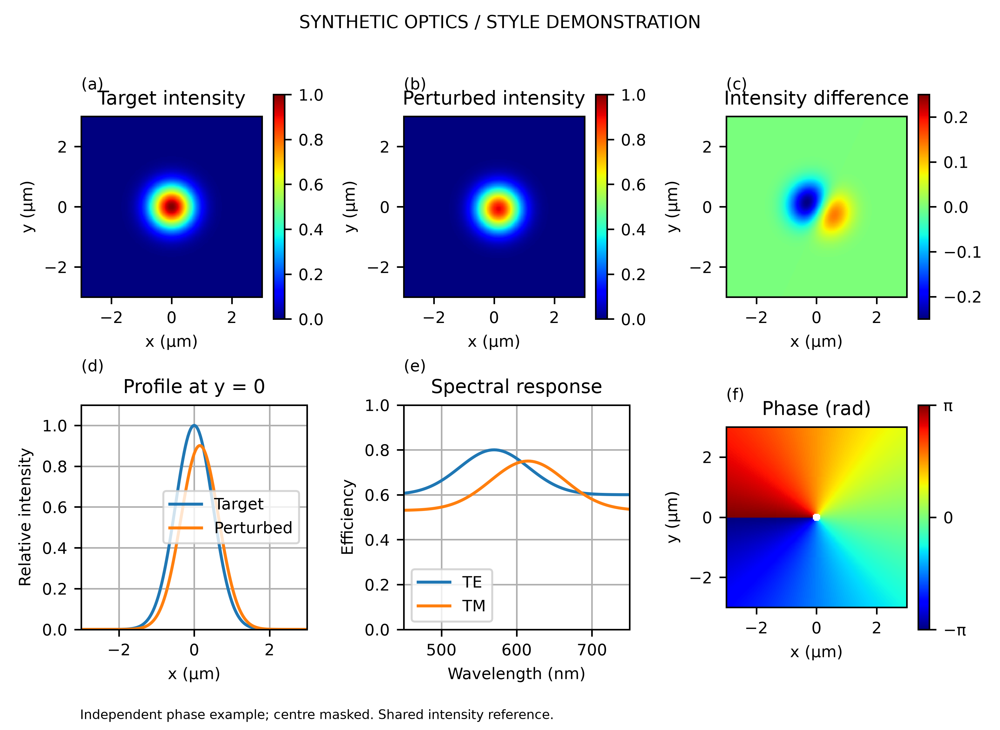
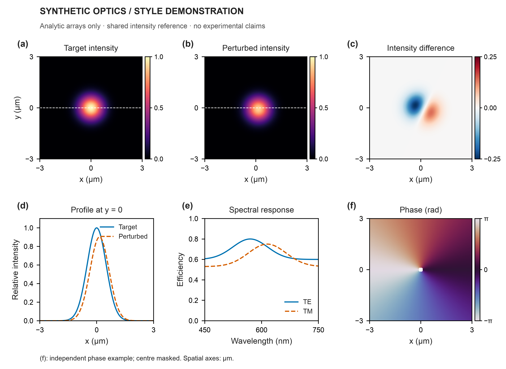

# Optica Paper Figure

**同一份工作、同一份数据、同一批图，做得更清楚、更好看。**

一个用于光学、光子学、超表面论文的绘图 skill。同步改进色调、布局、字体、线条与视觉叙事；全文统一视觉语言，各张大图按自己的论点组织，前后形成完整证据链。不是 Optica 官方模板。

## 从这里看

- [精简主规则](SKILL.md)：五条审美原则与实际改图流程。
- [14张精选参考原图](references/gallery.md)：直接看图，附逐图审美拆解；另有5篇Optica的指定图页入口。
- [全文统一与逐图差异](references/paper-narrative.md)：统一什么、变化什么，如何安排文章图序。
- [核心概念图与图文摘要](references/hero-figure.md)：把整篇贡献变成一个可记住的物理场景。
- [字体、色调、线条和留白参数](references/design-system.md)：明确可落地的细节，而非只谈理念。

## 调研依据

实际查看16篇研究的51张编号图，另补3篇研究的正式摘要区图：共19篇研究、51张编号图＋3张摘要图；还看过1张评论图，单独记录。原样本含5篇Optica，覆盖Nature Photonics、Light、Nature、Nature Communications；新增摘要图来自ACS Photonics与iScience。样本以超表面及相关光学为主，不是所有顶刊的统计调查。

[逐篇观察](references/evidence-atlas.md) · [来源清单](references/corpus.json) · [图片署名和许可证](references/THIRD_PARTY.md)

14张离线图片均核查为CC BY 4.0并逐图署名。其余论文保留原文入口，不把“能下载”当作“可任意转载”。建议参数与期刊官方要求分开；不能从截图猜出精确字体或线宽。

## 同样六个面板的改图示例

| 基础输出 | 视觉优化 |
|---|---|
|  |  |

这是明确标注的**合成数据演示**。面板数量、数据、掩膜、坐标范围与归一化保持一致；只调整视觉表达。脚本核对原始数组和实际绘图对象中的值、范围与坐标哈希。示例用于验证工作流，不代表研究结果，也不是要求所有图都排成2×3。

[矢量PDF](examples/after.pdf) · [可编辑SVG](examples/after.svg) · [一致性记录](examples/provenance.json) · [有限PDF检查](examples/audit.json)

## 使用

将本仓库放入你的 Codex skills 目录，目录名为 `opticapaperfig`；使用已配置的 `$CODEX_HOME/skills`，未配置时通常是 `~/.codex/skills`。

> 用 $opticapaperfig 优化这个代码库里的论文图。保持数据、归一化和已有结果不变，统一全篇字体、色调与制图风格，按各张图的论点分别设计版式，并检查前后叙事。

> 用 $opticapaperfig 根据我的研究做核心概念图／图文摘要，突出一个物理贡献，不拼满全部结果。

已有Python/MATLAB/R/矢量工作流优先；脚本是可选工具，不强制迁移语言。

```bash
# Python示例依赖：numpy、matplotlib；PDF检查另需pymupdf
python scripts/demo_optics.py --out-dir demo-output
python scripts/audit_pdf.py demo-output/after.pdf --width-mm 178
```

保留原始数据、误差、弱信号与失败区域，不用生成式图像冒充SEM或实验结果。自动检查不能替代科学判断和实际看图；投稿规格需核查目标期刊当时的要求。
