# 六组同数据前后对照

统一视觉语言，按不同论点改变版式。全部是合成练习；基础版和优化版使用相同数据、面板与科学含义。它们不构成真实器件的完整验证。

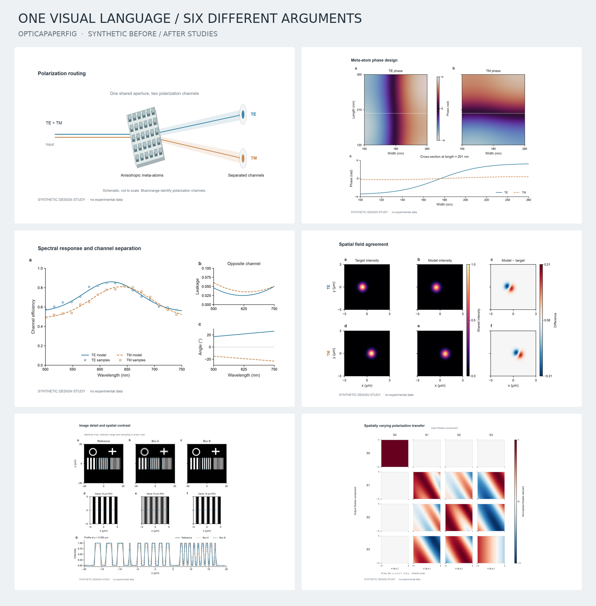

[下载六页对照PDF](comparisons.pdf) · [交互式示例册HTML](index.html)（下载后本地打开） · [一致性检查](verification.json)

## 01 · 核心机制图

输入、器件、输出：把同一组要素变成一个物理场景。

| 基础绘图 | opticapaperfig优化 |
|---|---|
| 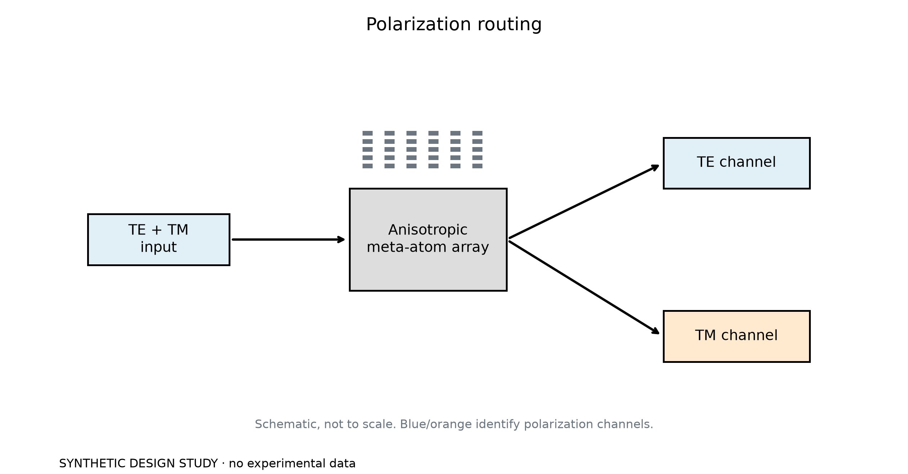 | 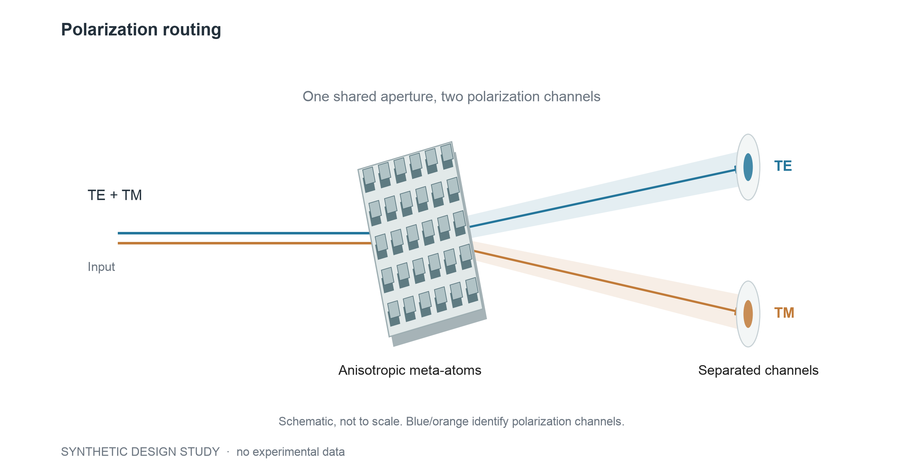 |

从方框连接改为共享孔径的斜视结构；输入与两个输出沿清楚的方向展开。蓝/橙仅表示TE/TM通道，器件本身退为低饱和材料色。

保留输入、30个各向异性单元、两个输出及全部连接关系。图形位置与视角改变；这是示意图，不是电磁仿真。

[PDF](figures/01-concept-after.pdf) · [SVG](figures/01-concept-after.svg) · [PNG](figures/01-concept-after.png)

## 02 · 参数设计与相位

两张同尺度响应图，接一条共同条件下的横截面。

| 基础绘图 | opticapaperfig优化 |
|---|---|
| 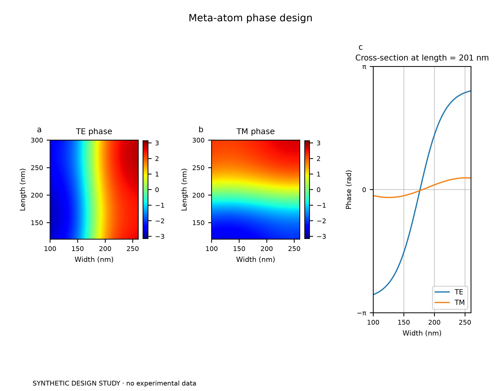 | 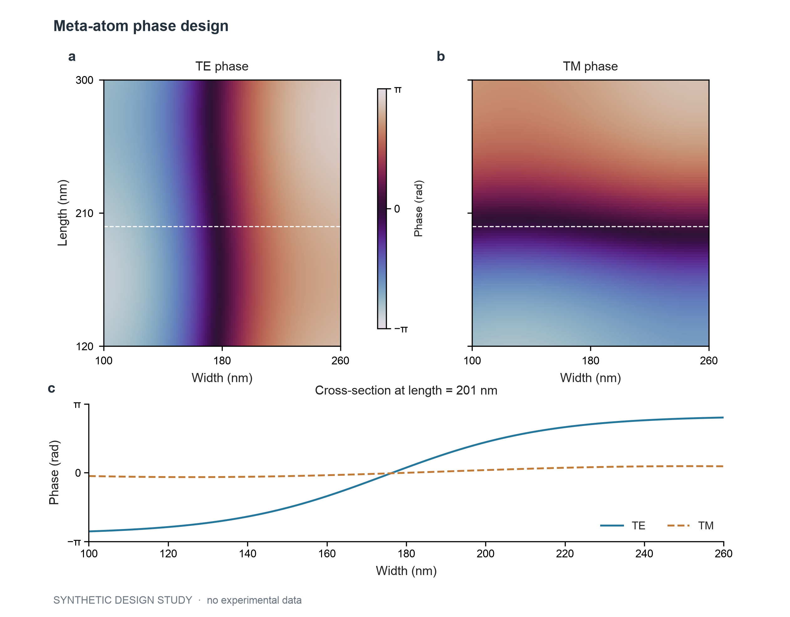 |

把并排挤压的三个面板改成上方双图、下方宽剖面；相位采用完整周期的循环色图，共用色条，剖面线在主图中可定位。

相位来自解析函数；图上截面为Length = 201 nm。所有取样值、坐标范围、色阶范围与剖面数组均保持不变。

[PDF](figures/02-phase-library-after.pdf) · [SVG](figures/02-phase-library-after.svg) · [PNG](figures/02-phase-library-after.png)

## 03 · 光谱与通道分离

主性能占大面积，泄漏和偏转角在侧面补充。

| 基础绘图 | opticapaperfig优化 |
|---|---|
| 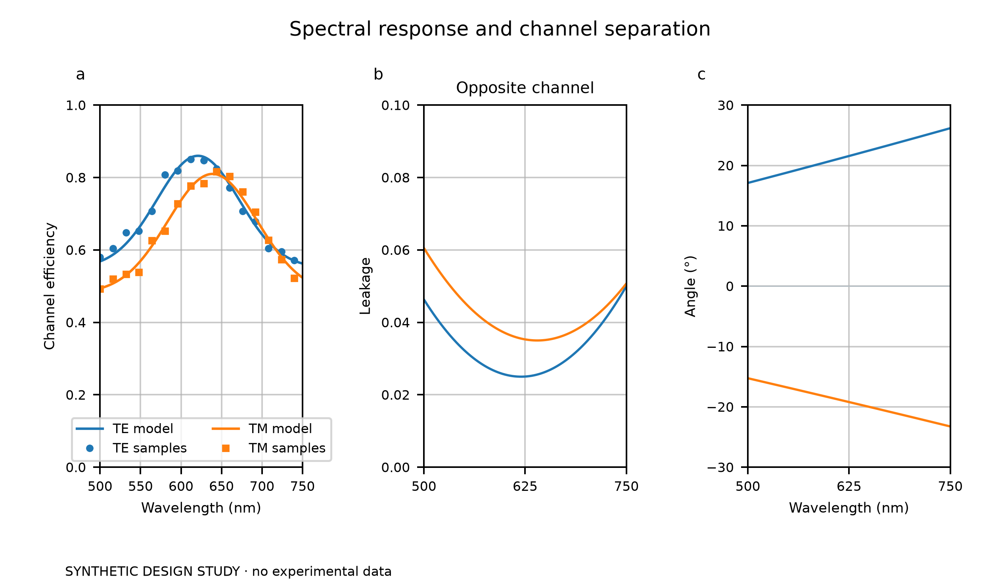 | 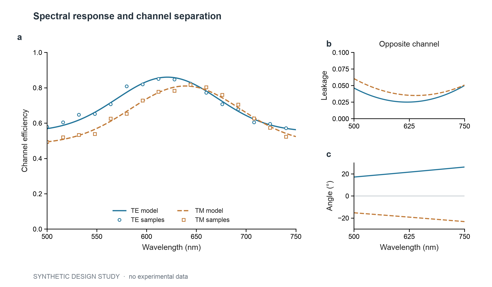 |

用不等宽布局明确主次；蓝/橙贯穿三个面板，实线/虚线和圆点/方点提供冗余编码。去掉重网格与图例边框，给主曲线留出面积。

曲线为解析模型，散点为固定随机种子的合成采样；不是实测。效率、泄漏与角度显示范围前后一致。

[PDF](figures/03-spectra-after.pdf) · [SVG](figures/03-spectra-after.svg) · [PNG](figures/03-spectra-after.png)

## 04 · 光场公平对照

行固定通道，列固定目标、模型与差值。

| 基础绘图 | opticapaperfig优化 |
|---|---|
| 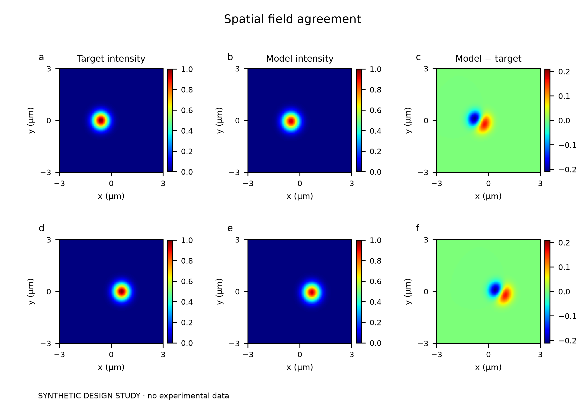 | 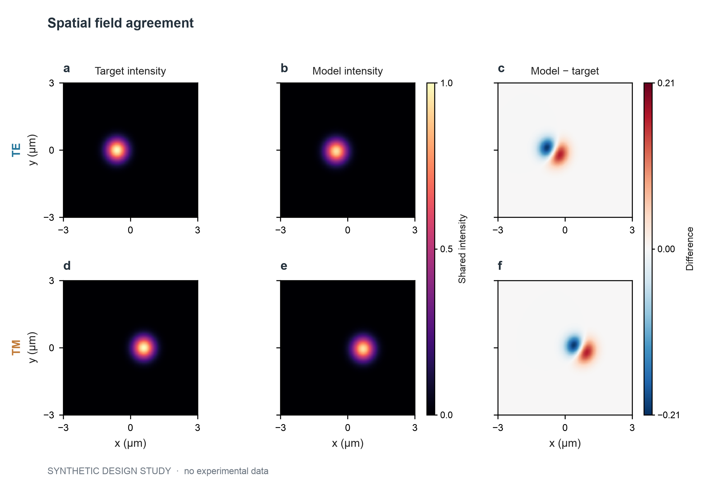 |

六个图块保留相同物理尺寸；非负强度用顺序色，正负差值用零中心发散色。两根共享色条明确比较基准，重复标注减到必要程度。

二维高斯目标与轻微偏移模型均为合成数组；无逐图归一化。残差范围覆盖全部值，坐标方向与像素范围不变。

[PDF](figures/04-field-comparison-after.pdf) · [SVG](figures/04-field-comparison-after.svg) · [PNG](figures/04-field-comparison-after.png)

## 05 · 成像、局部细节与剖面

整图→相同ROI→同一取样行，让图像观察落到曲线。

| 基础绘图 | opticapaperfig优化 |
|---|---|
| 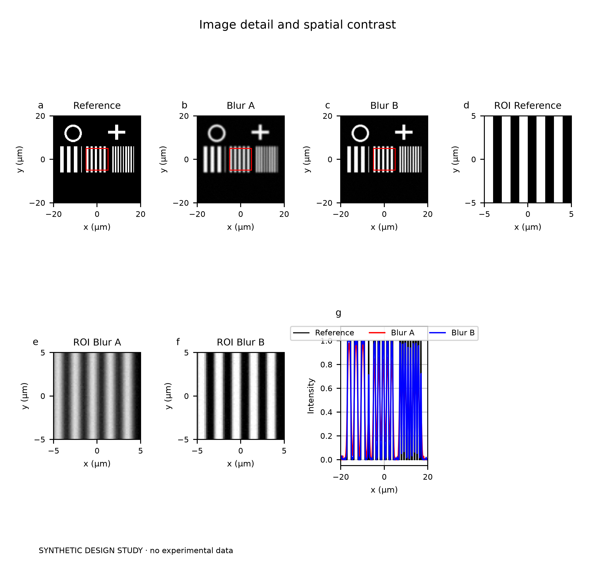 | 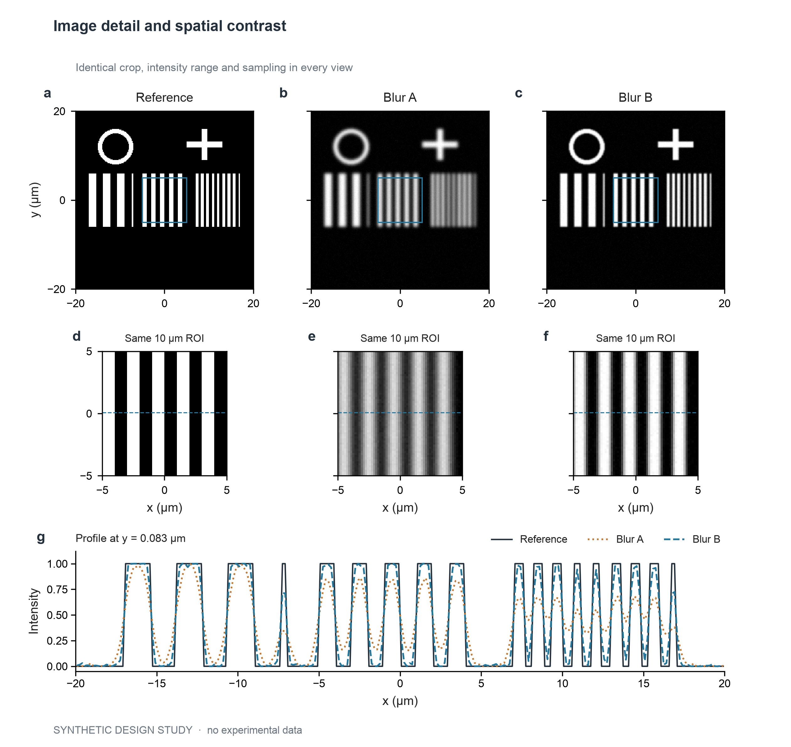 |

将七个散排面板组织成三列对应链，底部剖面横贯整行。图像保留灰度，蓝色框只定位ROI；图例移出曲线区域。

分辨率靶为程序生成，Blur A/B是已生成的两种模糊图。优化阶段不重做滤波或去噪；ROI和显示范围相同，剖面位于y = 0.083 μm。

[PDF](figures/05-imaging-after.pdf) · [SVG](figures/05-imaging-after.svg) · [PNG](figures/05-imaging-after.png)

## 06 · 偏振矩阵

数学索引就是排版：4×4关系一眼可读。

| 基础绘图 | opticapaperfig优化 |
|---|---|
| 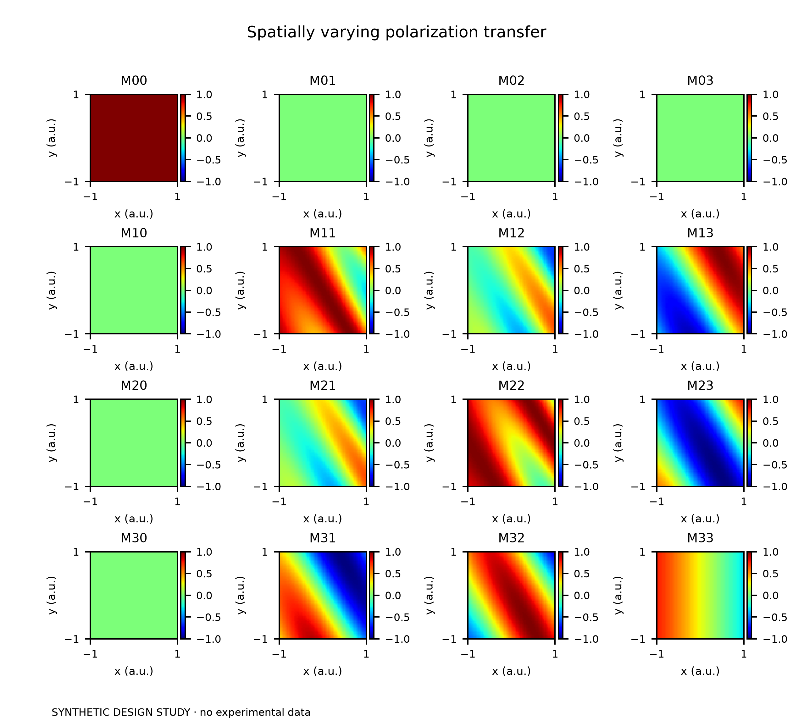 | 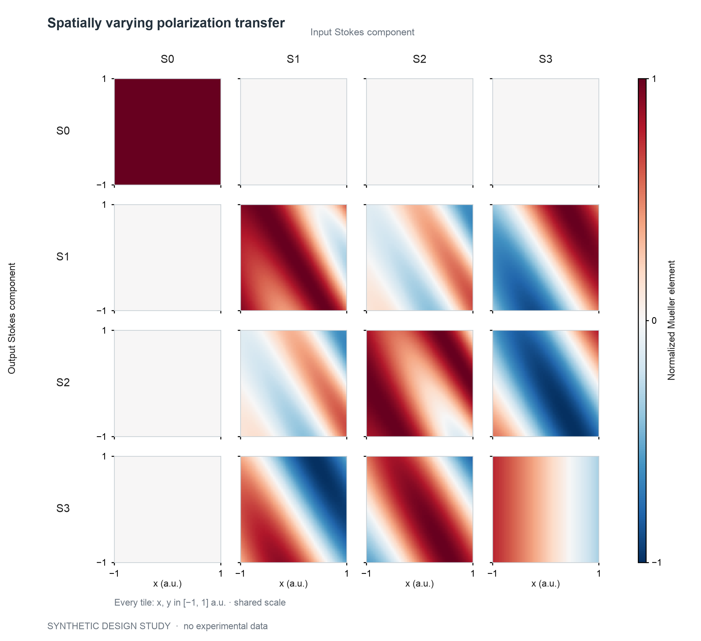 |

去掉16根重复色条，保留一个固定范围的零中心色条；行列标示输入/输出Stokes分量，只在外边显示坐标。重复结构服务比较，不为变化强行换版式。

使用解析的归一化无损延迟器Mueller矩阵：M00 = 1，3×3子块为Stokes空间旋转，已验证正交性。不是偏振测量数据。

[PDF](figures/06-mueller-after.pdf) · [SVG](figures/06-mueller-after.svg) · [PNG](figures/06-mueller-after.png)

## 复现

Python 3；依赖见[requirements.txt](requirements.txt)。

```bash
python scripts/render_suite.py
python scripts/build_gallery.py
```

修改已有工作时直接复用数据与绘图入口，不需要套用这些合成模型。
