# 精选原图：看哪里，学什么

**先看画面，再读规则。** 这里不是统一模板库：选图为了覆盖不同构图、色调和论证任务。每次按任务看2–4张，提取关系与视觉语言，不复制内容。
14张本地参考图：原样本中的11张编号图＋新增3张正式摘要区图。每张均已实际查看；保留原图，不用AI重绘。原图未必处处理想，下面同时写明不照搬的部分。
图片按各自CC BY 4.0条款附作者、出处、许可证及处理说明；完整记录见[THIRD_PARTY.md](THIRD_PARTY.md)和[gallery-manifest.json](gallery-manifest.json)。[浏览器图库](gallery.html)可离线打开。

## 快速选参考

| 任务 | 优先看 |
|---|---|
| 整篇核心概念／图文摘要 | G01、G02、N04-F1、N05-F1 |
| 极简机制与方法 | N09-F1、N09-F2 |
| 同文不同图的叙事 | N09-F1 → N09-F2 → N09-F8；N04-F1 → N04-F4 |
| 光路、传播、偏振与通道 | G02、N06-F1、N10-F1 |
| 多尺度结构与SEM | N04-F1、N12-F2 |
| 曲线、场图、成像、统计 | N09-F8、N07-F2、N10-F7、N04-F4 |

## N04-F1 · 机制与多尺度结构

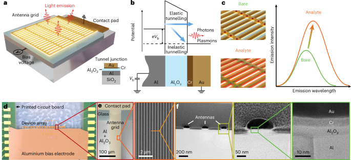

**学什么**：金属器件是主角，机制、响应与从宏观到纳米的证据各有位置。 **边界**：学尺度链与局部对应；彩色放大框不必用这么多。

Lee, Jihye et al., *Nature Photonics* (2025), Fig. 1 · [原文/图源](https://www.nature.com/articles/s41566-025-01708-y) · [图页/DOI](https://www.nature.com/articles/s41566-025-01708-y/figures/1) · [CC BY 4.0](https://creativecommons.org/licenses/by/4.0/)。处理说明见[署名清单](THIRD_PARTY.md)。

## N05-F1 · 一条光路讲清功能

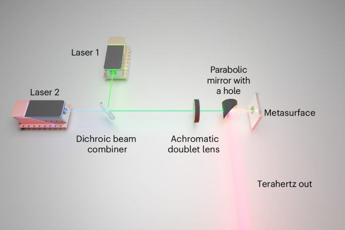

**学什么**：输入在左汇合，器件在右转化为输出，路径本身解释因果。 **边界**：学方向和主对象；背景渐变、长标签和装饰阴影可以更克制。

Krakofsky, J. H. et al., *Nature Photonics* (2026), Fig. 1 · [原文/图源](https://www.nature.com/articles/s41566-026-01889-0) · [图页/DOI](https://www.nature.com/articles/s41566-026-01889-0/figures/1) · [CC BY 4.0](https://creativecommons.org/licenses/by/4.0/)。处理说明见[署名清单](THIRD_PARTY.md)。

## N06-F1 · 扰动与恢复

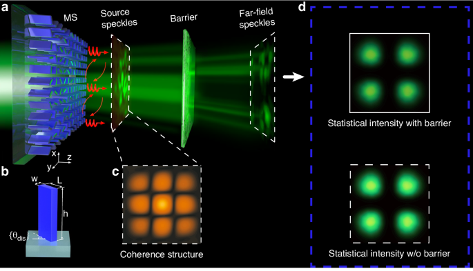

**学什么**：传播链和带/不带遮挡的结果相邻，绿色信号贯穿。 **边界**：学因果与对照；不要照搬高饱和蓝框和过强光晕。

Liu, Leixin et al., *Light: Science & Applications* (2024), Fig. 1 · [原文/图源](https://www.nature.com/articles/s41377-024-01485-3) · [图页/DOI](https://www.nature.com/articles/s41377-024-01485-3/figures/1) · [CC BY 4.0](https://creativecommons.org/licenses/by/4.0/)。处理说明见[署名清单](THIRD_PARTY.md)。

## N09-F1 · 极简概念比较

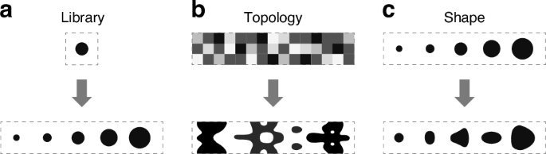

**学什么**：三列对齐、黑白轮廓、少量箭头，设计自由度不靠长文字解释。 **边界**：学用形状讲道理；复杂结构不应被简化到科学含义丢失。

Dainese, Paulo et al., *Light: Science & Applications* (2024), Fig. 1 · [原文/图源](https://www.nature.com/articles/s41377-024-01629-5) · [图页/DOI](https://www.nature.com/articles/s41377-024-01629-5/figures/1) · [CC BY 4.0](https://creativecommons.org/licenses/by/4.0/)。处理说明见[署名清单](THIRD_PARTY.md)。

## N09-F2 · 方法流程

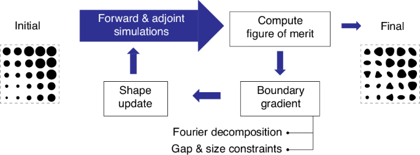

**学什么**：图形角色与回路组织优化逻辑，面板为流程让路。 **边界**：学步骤关系；算法箭头必须忠实于实际更新。

Dainese, Paulo et al., *Light: Science & Applications* (2024), Fig. 2 · [原文/图源](https://www.nature.com/articles/s41377-024-01629-5) · [图页/DOI](https://www.nature.com/articles/s41377-024-01629-5/figures/2) · [CC BY 4.0](https://creativecommons.org/licenses/by/4.0/)。处理说明见[署名清单](THIRD_PARTY.md)。

## N10-F1 · 颜色与物理通道

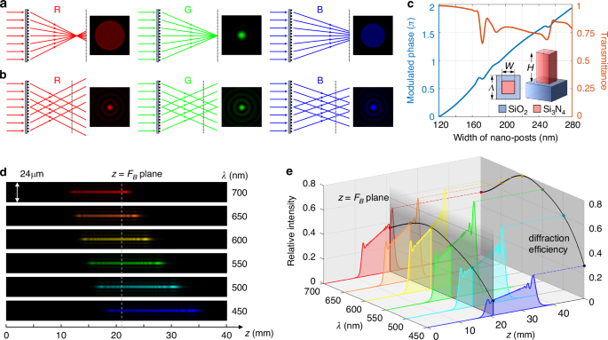

**学什么**：RGB既是波长通道，也是射线、光斑和传播结果的连接线索。 **边界**：学跨面板一致编码；双轴和3D曲线是否必要需另行判断。

Wang, Jianli et al., *Light: Science & Applications* (2026), Fig. 1 · [原文/图源](https://www.nature.com/articles/s41377-026-02272-y) · [图页/DOI](https://www.nature.com/articles/s41377-026-02272-y/figures/1) · [CC BY 4.0](https://creativecommons.org/licenses/by/4.0/)。处理说明见[署名清单](THIRD_PARTY.md)。

## N12-F2 · 不同证据共享秩序

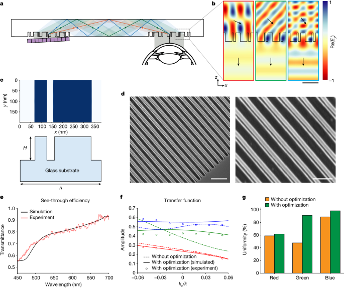

**学什么**：光路、场图、结构、SEM和性能依角色分块，结构证据占足面积。 **边界**：学尺寸分配与证据邻接；带符号场的新图优先用零中心发散色。

Gopakumar, Manu et al., *Nature* (2024), Fig. 2 · [原文/图源](https://www.nature.com/articles/s41586-024-07386-0) · [图页/DOI](https://www.nature.com/articles/s41586-024-07386-0/figures/2) · [CC BY 4.0](https://creativecommons.org/licenses/by/4.0/)。处理说明见[署名清单](THIRD_PARTY.md)。

## N09-F8 · 定量图的克制

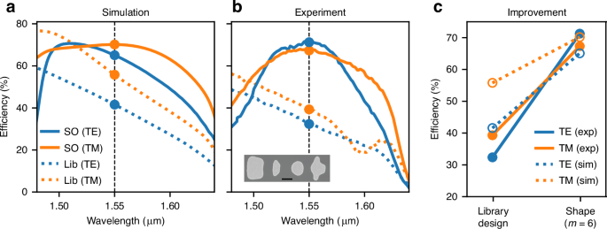

**学什么**：蓝橙稳定表示TE/TM，线型辅助区分，三列依次回答预测、实验、提升。 **边界**：学少色多义和等宽对照；图例与inset仍要逐项检查可读性。

Dainese, Paulo et al., *Light: Science & Applications* (2024), Fig. 8 · [原文/图源](https://www.nature.com/articles/s41377-024-01629-5) · [图页/DOI](https://www.nature.com/articles/s41377-024-01629-5/figures/8) · [CC BY 4.0](https://creativecommons.org/licenses/by/4.0/)。处理说明见[署名清单](THIRD_PARTY.md)。

## N07-F2 · 光谱到场分布

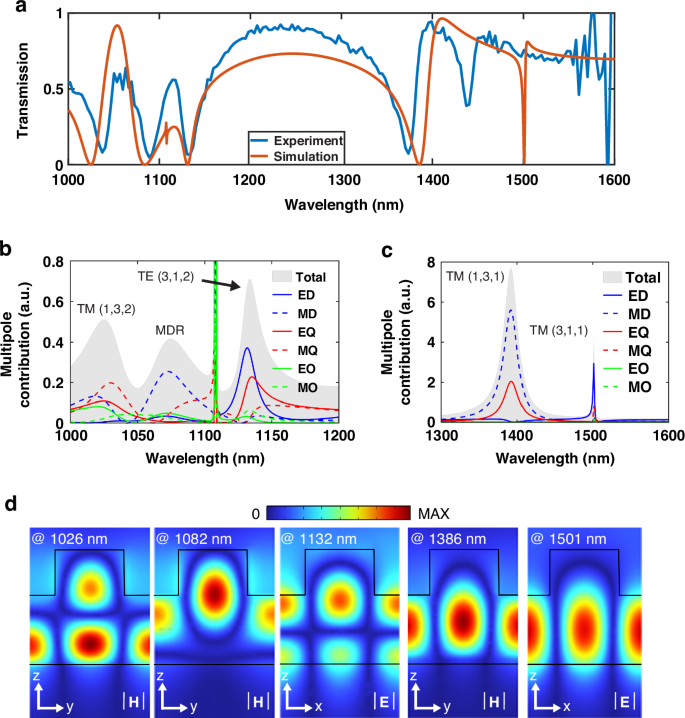

**学什么**：完整响应、分解信息与局部场相互定位，让曲线有机制解释。 **边界**：学一处谱特征接一组场证据；不同分量不要随意共色阶。

Zheng, Ze et al., *Light: Science & Applications* (2024), Fig. 2 · [原文/图源](https://www.nature.com/articles/s41377-024-01535-w) · [图页/DOI](https://www.nature.com/articles/s41377-024-01535-w/figures/2) · [CC BY 4.0](https://creativecommons.org/licenses/by/4.0/)。处理说明见[署名清单](THIRD_PARTY.md)。

## N10-F7 · 成像与剖面

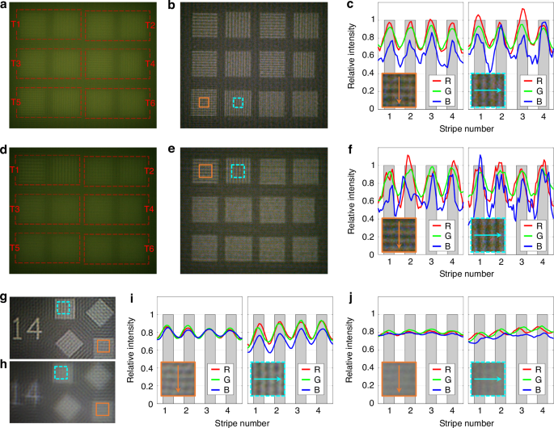

**学什么**：同位置ROI与线剖面连接图像观察和定量判断。 **边界**：学固定比较位置；不为了漂亮裁掉失败或失焦区域。

Wang, Jianli et al., *Light: Science & Applications* (2026), Fig. 7 · [原文/图源](https://www.nature.com/articles/s41377-026-02272-y) · [图页/DOI](https://www.nature.com/articles/s41377-026-02272-y/figures/7) · [CC BY 4.0](https://creativecommons.org/licenses/by/4.0/)。处理说明见[署名清单](THIRD_PARTY.md)。

## N04-F4 · 检测证据的层次

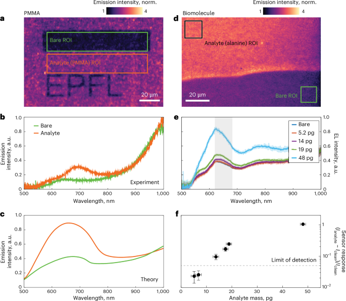

**学什么**：图像、ROI、谱线、校准和误差分组，观察逐步转为可判断的量。 **边界**：学视觉证据到量化证据的过渡；密集图先整理任务再缩字号。

Lee, Jihye et al., *Nature Photonics* (2025), Fig. 4 · [原文/图源](https://www.nature.com/articles/s41566-025-01708-y) · [图页/DOI](https://www.nature.com/articles/s41566-025-01708-y/figures/4) · [CC BY 4.0](https://creativecommons.org/licenses/by/4.0/)。处理说明见[署名清单](THIRD_PARTY.md)。

## G01 · 对照型图文摘要

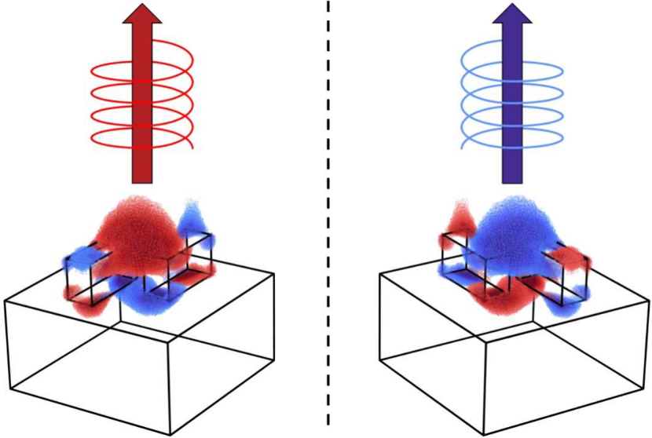

**学什么**：共同几何与左右状态相互映照，方向和手性成为主角，几乎不依赖文字。 **边界**：学少元素与强差异；光学旋向及时间约定不能凭外观改动。

Jose Luis Pura et al., *ACS Photonics* (2024), Graphical / TOC abstract · [原文/图源](https://pure.tue.nl/ws/portalfiles/portal/343330501/pura-et-al-2024-superchiral-light-emerging-from-bound-states-in-the-continuum-in-metasurfaces-of-si-nanorod-dimers.pdf) · [图页/DOI](https://doi.org/10.1021/acsphotonics.4c00938) · [CC BY 4.0](https://creativecommons.org/licenses/by/4.0/)。处理说明见[署名清单](THIRD_PARTY.md)。

## G02 · 传播型图文摘要

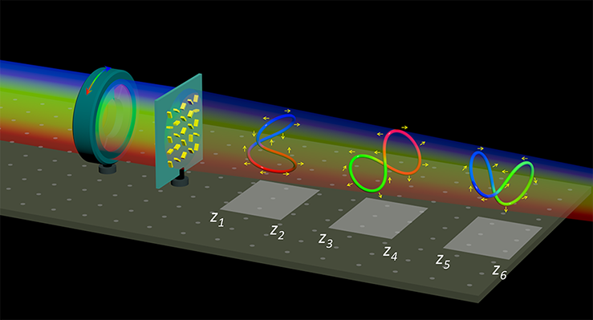

**学什么**：一条连续传播轴把器件、不同平面和偏振轨迹串起来，空间安排就是内容。 **边界**：学一条主路径与分层输出；暗背景需保证标签和弱信号清楚。

Yan Li et al., *ACS Photonics* (2024), Graphical / TOC abstract · [原文/图源](https://pure.hw.ac.uk/ws/portalfiles/portal/141750188/li-et-al-2024-multiple-multicolored-3d-polarization-knots-arranged-along-light-propagation.pdf) · [图页/DOI](https://doi.org/10.1021/acsphotonics.4c01341) · [CC BY 4.0](https://creativecommons.org/licenses/by/4.0/)。处理说明见[署名清单](THIRD_PARTY.md)。

## G03 · 多通道图文摘要（补充类型）

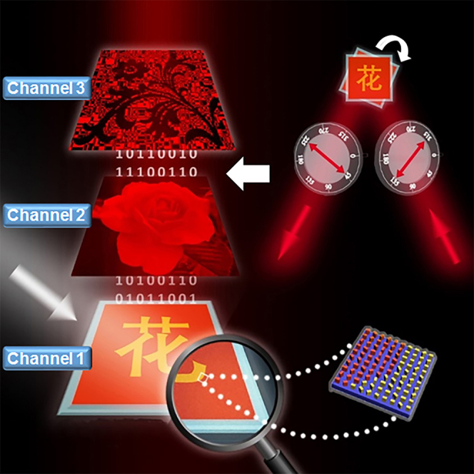

**学什么**：同一器件对应不同解码条件和三种输出，一体多用有可见结构。 **边界**：学通道关系；发光、数字纹理与标签太多时会争夺焦点，不照搬装饰。

Zile Li et al., *iScience* (2021), Graphical / TOC abstract · [原文/图源](https://pmc.ncbi.nlm.nih.gov/articles/PMC8669004/) · [图页/DOI](https://doi.org/10.1016/j.isci.2021.103510) · [CC BY 4.0](https://creativecommons.org/licenses/by/4.0/)。处理说明见[署名清单](THIRD_PARTY.md)。

## Optica及其他精选入口（不附本地图片）

下列图也已实际查看，但未确认允许在此重新分发的具体图像条款，保留图页/PDF入口。打开指定页看图，不用标题或图注代替视觉观察。

| 来源 | 指定参考 | 值得学 |
|---|---|---|
| [O02 · 3D communication-mode optics](https://pure.tue.nl/ws/portalfiles/portal/367405705/optica-12-9-1502.pdf) | F3 PDF第7页；F4第8页；F5第10页 | 从设计到实测的路径与三维结果矩阵；边框可减轻 |
| [O07 · Computational complex field imaging](https://authors.library.caltech.edu/records/bhh5g-xxv45) | F1/F2 PDF第2页；F3第4页 | 光学与计算衔接，幅度/相位分工 |
| [O08 · Chromatic dispersion](https://authors.library.caltech.edu/records/nnf8v-92988) | F1第2页；F2第3页；F5第6页 | 机制、设计、实验三张大图采用不同空间组织 |
| [O09 · 2.5D metastructures](https://authors.library.caltech.edu/records/jxqdh-gnr74) | F1第2页；F2第3页；F6第6页 | 简洁结构、SEM、光路、正交焦场与剖面相互印证 |
| [O10 · Ultralow-light color imaging](https://eprints.gla.ac.uk/216252/) | F1第2页；F2第3页；F11/F12第6页 | 材质与光场色调、RGB语义、低光条件矩阵 |
| [N01 · 360° structured light](https://www.nature.com/articles/s41566-024-01450-x/figures/1) | F1；同文F2/F4 | 核心场景、优化流程、实验证据采用不同构图 |
| [N02 · Mueller matrix imaging](https://www.nature.com/articles/s41566-024-01426-x/figures/1) | F1；同文F2/F5 | 器件/光束角色色与密集矩阵的分组 |
| [N12 · Holographic AR](https://www.nature.com/articles/s41586-024-07386-0/figures/4) | F1/F4 | 原理对比与成像比较；图中部分示例素材另有署名 |

全篇原始研究清单与观察见[evidence-atlas.md](evidence-atlas.md)。正式GA的说明见[hero-figure.md](hero-figure.md)，全文图序见[paper-narrative.md](paper-narrative.md)。
